# VERITY AI — Complete A-to-Z Technical Documentation & ML Learning Guide

> **Document Type:** Master Architectural Forensic Audit & Machine Learning Textbook  
> **Target Audience:** Engineering Interviews, Technical Reviews, Architecture Demonstrations  
> **Language / Medium:** Telugu-English Transliteration (Tenglish) with Standard English Technical Terminology  
> **Repository:** Modepalli-Ravindra/VERITY_AI  
> **Current Version:** V5 Architecture (ModernBERT-base + 20-D Stylometric Fusion) with V2 Rollback Target  

---

## TABLE OF CONTENTS

1. [CHAPTER 1 — Forensic Evidence & Repository Inventory](#chapter-1--forensic-evidence--repository-inventory)
2. [CHAPTER 2 — Project Overview from Absolute Zero](#chapter-2--project-overview-from-absolute-zero)
3. [CHAPTER 3 — High-Level Architecture & End-to-End System Diagrams](#chapter-3--high-level-architecture--end-to-end-system-diagrams)
4. [CHAPTER 4 — Complete Frontend Architecture & Deep Dive](#chapter-4--complete-frontend-architecture--deep-dive)
5. [CHAPTER 5 — Backend Engineering & FastAPI Lifecycle](#chapter-5--backend-engineering--fastapi-lifecycle)
6. [CHAPTER 6 — Database, Storage & InsForge BaaS Persistence](#chapter-6--database-storage--insforge-baas-persistence)
7. [CHAPTER 7 — Machine Learning Fundamentals from Absolute Zero](#chapter-7--machine-learning-fundamentals-from-absolute-zero)
8. [CHAPTER 8 — Detection Models Forensic Audit: ModernBERT V5 vs DistilRoBERTa V2](#chapter-8--detection-models-forensic-audit-modernbert-v5-vs-distilroberta-v2)
9. [CHAPTER 9 — The 20 Stylometric & Linguistic Features Deep Dive](#chapter-9--the-20-stylometric--linguistic-features-deep-dive)
10. [CHAPTER 10 — Feature Fusion Mathematics & Neural Classifier Head](#chapter-10--feature-fusion-mathematics--neural-classifier-head)
11. [CHAPTER 11 — Training Pipeline, Datasets & Leakage Prevention](#chapter-11--training-pipeline-datasets--leakage-prevention)
12. [CHAPTER 12 — Evaluation Metrics, Calibration & Real-World Accuracy](#chapter-12--evaluation-metrics-calibration--real-world-accuracy)
13. [CHAPTER 13 — Pin-to-Pin Inference Pipeline Walkthrough](#chapter-13--pin-to-pin-inference-pipeline-walkthrough)
14. [CHAPTER 14 — Document Intelligence: PDF, DOCX & TXT Engine](#chapter-14--document-intelligence-pdf-docx--txt-engine)
15. [CHAPTER 15 — Comparison Engine & Adversarial Robustness Lab](#chapter-15--comparison-engine--adversarial-robustness-lab)
16. [CHAPTER 16 — Paraphrasing, Humanization & Section Preservation Engine](#chapter-16--paraphrasing-humanization--section-preservation-engine)
17. [CHAPTER 17 — Forensic Audit of All 22 Platform Capabilities](#chapter-17--forensic-audit-of-all-22-platform-capabilities)
18. [CHAPTER 18 — Security, Performance & Reliability Engineering](#chapter-18--security-performance--reliability-engineering)
19. [CHAPTER 19 — Comprehensive Technical Glossary (A to Z)](#chapter-19--comprehensive-technical-glossary-a-to-z)
20. [CHAPTER 20 — Comprehensive Interview Preparation & Master Q&A](#chapter-20--comprehensive-interview-preparation--master-qa)

---

# CHAPTER 1 — FORENSIC EVIDENCE & REPOSITORY INVENTORY

## 1.1 Forensic Audit Ground Rules
Mana project lo prathi technical claim ki codebase lo direct proof undali. 
Mana rule:
1. **Implemented & Verified in Code**: Direct file path, function name, class structure, and test evidence prove cheyyagaligedi.
2. **Experimentally Evaluated**: Datasets and offline benchmark artifacts lo prove ayyindi.
3. **Unverified / Missing Artifacts**: Codebase lo direct proof leni vaatiki explicitly:  
   `Codebase lo verify cheyyadaniki evidence dorakaledu.` ani transparent ga declare chestam.

## 1.2 Repository File Inventory & Evidence Table

| Component | Repository File Path | Key Class / Function / Artifact | Actual Observed Behavior | Status |
|---|---|---|---|---|
| **Backend Main** | `backend/app/main.py` | `FastAPI()`, `CORSMiddleware`, SlowAPI `Limiter` | Server entrypoint, CORS handling, rate limit exception handlers | Implemented & Verified |
| **API Router** | `backend/api/router.py` | `analyze_text`, `analyze_file`, `humanize_text`, `select_model` | Handles `/api/analyze`, `/api/analyze-file`, `/api/humanize`, `/api/models` | Implemented & Verified |
| **Auth Dependency** | `backend/api/auth.py` | `get_current_user` | Decodes JWT via InsForge secret/public keys, extracts user ID | Implemented & Verified |
| **Primary Model (V5)** | `backend/ml/experimental/verity_v5_model.py` | `VerityV5Model`, `ModernBERTEncoder` | Fuses ModernBERT-base 768-D representation with 20-D stylometrics | Implemented & Verified |
| **V5 Inference** | `backend/ml/experimental/v5_inference.py` | `V5InferenceService.analyze()` | Checkpoint `best_model.pt` (679MB) + `v5_scaler.json`, dynamic tokenization, threshold 0.70 | Implemented & Verified |
| **Rollback Model (V2)** | `backend/ml/fusion_model.py` | `FeatureFusionDetector.evaluate()` | Checkpoint `backend/models/verity_detector_v2/best_model.pt`, DistilRoBERTa + 20-D stylometrics, threshold 0.50 | Implemented & Verified |
| **Fusion Head** | `backend/ml/verity_model.py` | `VerityFusionClassifier` | 768-D → 256-D, 20-D → 64-D, Concatenation = 320-D → 128-D → 1 logit | Implemented & Verified |
| **Stylometrics** | `backend/ml/stylometrics.py` | `StylometricExtractor.get_vector()` | Computes exact 20 linguistic, syntactic, and structural metrics | Implemented & Verified |
| **Chunking Engine** | `backend/ml/text_chunking.py` | `chunk_document_bounded()`, `chunk_text()` | Splits documents into bounded character chunks (50 to 1500 chars, max 50 chunks) | Implemented & Verified |
| **Document Parser** | `backend/services/document_parser.py` | `DocumentParser.extract_text()` | Validates Magic bytes (`%PDF`, `PK\x03\x04`), 10MB limit, 200 page limit, parses PDF, DOCX, TXT | Implemented & Verified |
| **Humanizer Engine** | `backend/services/llm_providers.py` | `LLMProviderService.humanize_text()` | Calls Groq, NVIDIA, OpenRouter, Google with fallback to `_advanced_local_humanize` | Implemented & Verified |
| **Provider Manager** | `backend/services/provider_manager.py` | `ProviderManager.analyze()`, `analyze_document()` | Routes between local ML model and emergency LLM fallback, caches responses | Implemented & Verified |
| **Verification & Provenance** | `backend/services/verification_service.py` | `VerificationService.create_provenance_record()` | Generates `VRTY-YYYYMMDD-HEX` ID, SHA-256 hash, SVG QR badge, intelligence graph | Implemented & Verified |
| **Monitoring Service** | `backend/services/monitoring_service.py` | `MonitoringService.get_metrics()` | Tracks requests, error rates, p50 and p95 latency in rolling deque | Implemented & Verified |
| **Frontend Root** | `frontend/src/App.tsx`, `main.tsx` | App shell, navigation router, theme provider | Client routing across 12 pages with responsive dark UI | Implemented & Verified |
| **BaaS Client** | `frontend/src/lib/insforge.ts` | `createClient(@insforge/sdk)` | Manages JWT token storage, refresh, and InsForge database calls | Implemented & Verified |
| **History Service** | `frontend/src/services/historyService.ts` | `HistoryService.recordAnalysis()` | Inserts records into InsForge tables `analyses`, `humanizations`, `comparisons` | Implemented & Verified |
| **Compare Engine** | `frontend/src/pages/ComparePage.tsx` | `ComparePage`, `computeComparisonMetrics` | Calculates AI Signal Change in percentage points, prevents `NaN` | Implemented & Verified |
| **Probability Utils** | `frontend/src/utils/probability.ts` | `extractAiProbability`, `normalizeProbability` | Handles 0.0-1.0 and 0-100 range normalizations, rejects non-finite values | Implemented & Verified |
| **In-Domain Dataset** | `dataset/v5/train.csv`, `dataset/hc3/` | HC3 (Human ChatGPT Comparison Corpus) | 68,345 train, 16,070 val samples, split at question level | Implemented & Verified |
| **Out-of-Domain Benchmark**| `dataset/raid/` | RAID Benchmark 20K | 10,000 Human, 10,000 AI samples across 11 adversarial attacks | Implemented & Verified |
| **Offline Ablations** | `backend/ml/run_v2_ablations.py` | Ablation script | Compares Semantic-Only vs Stylometric-Only vs Fusion | Implemented & Verified |

---

# CHAPTER 2 — PROJECT OVERVIEW FROM ABSOLUTE ZERO

## 2.1 Ee Project Enduku Puttindi? What Problem Does VERITY Solve?
Manam 2024-2026 era lo unnam. ChatGPT, Claude, LLaMA, Gemini lanti Large Language Models (LLMs) vachina tarvata internet lo text generate cheyyadam chala easy aypoindi:
- Student essays and research papers AI tho rayistunnaru.
- News articles, fake news, and customer reviews bots generate chestunnai.
- Enterprise documentation and code explanations synthetic text tho fill aypotunnai.

Kani problem enti ante: **Ordinary AI detectors chala brittle (weak) ga unnayi**.
1. **High False Positive Rate on Human Text:** Oka formal human writer (for example, academic student essay or legal contract) raste, traditional detectors "Idi AI rasindi!" ani false accuse chestunnai.
2. **Easily Fooled by Paraphrasing (Adversarial Brittleness):** AI generate chesina text ni teesukuni chinna prompt "rewrite this to sound more human" ani isthe, ordinary AI detectors completely bypass aypotunnai.

**VERITY AI ee two core problems ni solve cheyyadaniki create chesina platform:**
- Idi kevalam oka word-counting tool kadu.
- Idi deep transformer semantic embeddings (768-dimensional space) ni **20 distinct human writing habits (stylometric features)** tho fuse chesi accurate decision teesukuntundi.
- In addition to detection, idi **Adversarial Robustness Lab** ni provide chestundi: text ni paraphrase chesinappudu AI signal ela degrade avtundo real-time lo "Compare" tool dwara visual ga chupistundi.

## 2.2 AI-Generated Text Detection Ante Enti?
Simple ga cheppalante: **Binary Classification problem in Natural Language Processing (NLP)**.
- Mana model munduki oka text string vastundi.
- Model text ni chadivi oka mathematical probability calculate chestundi:
  $$P(\text{Text is AI Generated}) \in [0.0, 1.0]$$
- Aa score mana locked decision threshold (V5 lo 0.70, V2 lo 0.50) kanna ekkuva unte:  
  **"Likely AI Generated"** ani classify chestam.
- Threshold kanna thakkuva unte:  
  **"Likely Human Written"** ani classify chestam.

## 2.3 AI Text Detection Enduku Chala Difficult?
Chaala mandi anukuntaru: "AI text lo spelling mistakes undavu, kabatti grammar chusi cheppocchu" ani. But that is completely WRONG!
1. **LLMs mimic human vocabulary:** Modern models (GPT-4o, Claude 3.5, LLaMA-3) human internet data meeda train ayyayi. Avi human style tone ni perfectly copy chestayi.
2. **Short Text Variance:** Text 50 words kanna thakkuva unte, statisticians kuda distinguish cheyaleru. Statistical variance undadu.
3. **Formal Human Writing resembles AI:** Humans chala formal ga, transition words ("Furthermore", "Moreover", "In conclusion") petti raste, adi early GPT models rase style lane kanipistundi.
4. **Paraphrase Attacks:** Chinna prompt tho words marchagane syntactic patterns alter aypotayi.

## 2.4 Inputs & Outputs of VERITY
- **Inputs:**
  1. Plain text string (minimum 50 characters, maximum 100,000 characters).
  2. Uploaded files: `.pdf`, `.docx`, `.txt` (maximum file size 10MB, max 200 pages).
- **Outputs:**
  1. `ai_probability` (0.0 to 1.0 floating point number).
  2. `human_probability` ($1.0 - \text{ai\_probability}$).
  3. `classification` ("Likely AI Generated" or "Likely Human Written").
  4. `confidence` ("High", "Medium", "Low" depending on distance from threshold).
  5. `explanation` (Contextual reason for the decision).
  6. `stylometric_features` (Detailed dictionary of 20 linguistic metrics).
  7. `risk_scoring` (Critical Risk, Elevated Risk, Moderate/Mixed, Low Risk).
  8. `verification_id` (Unique cryptographic provenance ID like `VRTY-20261011-DEMO0001`).
  9. `provenance` (SHA-256 content hash, digital signature hash, and vector SVG QR badge).

## 2.5 Who Might Use This Application?
1. **Academic Institutions & Professors:** Student submissions and research papers integrity verify cheyyadaniki.
2. **Publishers & Content Editors:** SEO articles, books, and journalism content bot-written kaada ani check cheyyadaniki.
3. **HR & Recruiters:** Resume cover letters and candidate coding explanations authentic ga unnaaya ani telusukovadaniki.
4. **ML Researchers & Students:** How transformer models degrade under adversarial attacks ani study cheyyadaniki.

## 2.6 Core Terminology Differences
Chala mandi interview lo ee 4 concepts ni confuse chestaru:
- **Detection (AI Text Detection):** Given text AI generate chesinda leda human rasada ani predict chese ML classification task.
- **Verification (Cryptographic Provenance):** Okasari analyze chesina content ki unique SHA-256 hash generate chesi public portal lo immutable trust record create cheyyadam.
- **Comparison (Adversarial Compare):** Original text probability ki mariyu rewritten/humanized text probability ki madhya unna percentage point drop (AI Signal Change) ni calculate cheyyadam.
- **Paraphrasing (Humanization):** Text meaning marchakunda, robotic AI phrases ni remove chesi organic human tone loki rewrite chese generative LLM task.

## 2.7 Operations Breakdown: ML vs Conventional Logic vs LLM vs Database

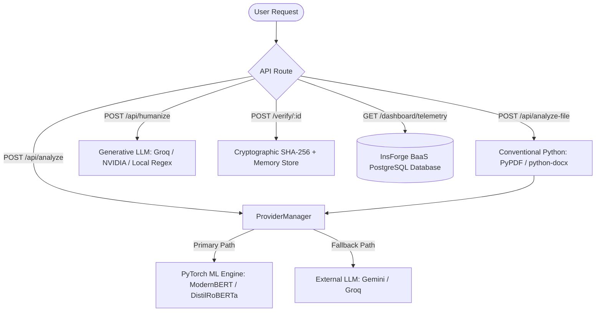

- **Operations using Local ML Models:**
  - Semantic feature extraction via Transformer encoder (768-D).
  - Neural feature fusion via `VerityFusionClassifier` (320-D).
  - Binary classification head outputting probability.
- **Operations using Conventional Python Logic:**
  - Text cleaning and NFKC unicode normalization (`text_preprocessing.py`).
  - 20-D Stylometric feature vector calculations (`stylometrics.py`).
  - Document parsing from PDF, DOCX, TXT byte buffers (`document_parser.py`).
  - Bounded text chunking (`text_chunking.py`).
  - Cryptographic SHA-256 hashing and SVG QR code rendering (`verification_service.py`).
  - Rolling latency calculation in p50/p95 deque (`monitoring_service.py`).
- **Operations depending on External LLM Providers:**
  - Text paraphrasing / Humanization (`/api/humanize`) via Groq (`openai/gpt-oss-120b`), NVIDIA (`meta/llama-3.2-11b-vision-instruct`), OpenRouter, Google Gemini.
  - Emergency fallback detection if PyTorch model crashes or is unavailable.
- **Operations requiring Database / Persistent Storage:**
  - User authentication and session management (InsForge BaaS `auth.users`).
  - Audit trail and history logs (`analyses`, `humanizations`, `comparisons` tables).
  - Telemetry counters and volume per day visualization.

## 2.8 System Limitations (Forensic Truth)
1. **Short text limit:** Text < 50 characters unte backend HTTP 400 reject chestundi (`Text is too short for meaningful analysis`). Statistical stylometrics requires sufficient sample size.
2. **Formulaic human false positives:** Legal contracts or highly structured technical manuals naturally have low sentence length variance, which can sometimes produce elevated AI risk scores.
3. **In-memory state in single process:** Provenance records and SlowAPI rate limiter state local server memory lo untayi. Distributed multi-instance deployment lo Redis or Postgres persistence kavali.

---

# CHAPTER 3 — HIGH-LEVEL ARCHITECTURE & SYSTEM DIAGRAMS

## 3.1 Overall Application Architecture

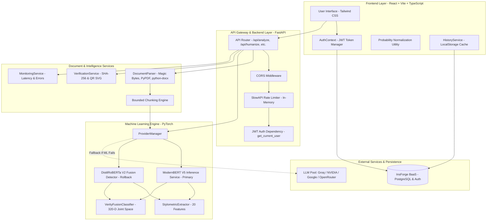

### Step-by-Step Explanation in Tenglish:
1. **Client (Browser):** User React UI lo text paste chesi leda document upload chesi click chestadu.
2. **Security & Gatekeeper:** Request FastAPI gateway ki vachinappudu:
   - CORS domain allow chestundi.
   - SlowAPI limiter check chestundi (e.g., max 20 requests per minute).
   - `get_current_user` JWT token ni validate chestundi.
3. **Orchestrator (`ProviderManager`):** Request ni receive chesukuni, text length > 20,000 characters unte chunking pipeline ki pampistundi; lekapothe direct analysis ki execute chestundi.
4. **ML Core:** Text nunchi parallel ga 20 stylometrics extract chesi, transformer encoder loki pass chestundi. Fusion head 320-D vector create chesi binary probability compute chestundi.
5. **Persistence & Provenance:** Cryptographic hash generate chesi record create chestundi, background lo InsForge PostgreSQL lo audit history save avtundi.

## 3.2 Frontend-to-Backend Request Flow (Sequence Diagram)

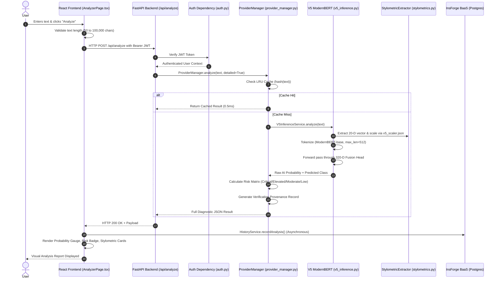

---

# CHAPTER 4 — COMPLETE FRONTEND ARCHITECTURE

## 4.1 Frontend Tech Stack & Setup
- **Framework:** React 18 with Vite build tool. Fast HMR (Hot Module Replacement) and optimized production rollup bundle.
- **Language:** TypeScript with strict type checking.
- **Styling:** Tailwind CSS with custom glow animations, glassmorphism card surfaces, and dark-mode first aesthetic (`#0B130E` dark slate canvas with `#A3E635` / `#E4FD97` neon accents).
- **Icons & Animation:** Heroicons (`@heroicons/react/24/outline`), Framer Motion for smooth micro-interactions.
- **BaaS Client:** `@insforge/sdk` for authentication and database queries.

## 4.2 Page Structure & Navigation Router
Frontend lo router `frontend/src/App.tsx` lo manage avtundi:

| Page Route | Component File | Purpose & Functionality |
|---|---|---|
| `/` | `LandingPage.tsx` | High-conversion hero landing page with live interactive demo snippet, capability showcase |
| `/login` | `LoginPage.tsx` | Email/password login and magic link auth via InsForge SDK |
| `/signup` | `SignUpPage.tsx` | New user registration with email verification workflow |
| `/logout` | `LogoutPage.tsx` | Session termination, token purge, redirect to landing |
| `/analyzer` | `AnalyzerPage.tsx` | Core text & document detection workplace with interactive gauge, sentence highlighting |
| `/compare` | `ComparePage.tsx` | Side-by-side adversarial comparison testing original vs paraphrased text |
| `/paraphrase` | `ParaphrasePage.tsx` | Multi-tone humanization studio (Natural, Professional, Academic, Casual) |
| `/dashboard` | `DashboardPage.tsx` | User telemetry, historical volume charts, recent scan logs |
| `/history` | `HistoryPage.tsx` | Complete searchable, filterable history table of past detections |
| `/docs` | `DocumentationPage.tsx` | In-app API documentation, code examples in cURL and Python |
| `/demo` | `DemoPage.tsx` | Guided product walkthrough for stakeholder reviews |
| `/settings` | `SettingsPage.tsx` | Profile configuration and active model selection |

## 4.3 State Management & Authentication Flow
- **Authentication Context (`frontend/src/context/AuthContext.tsx`):**
  - Manages `user`, `session`, `loading` states.
  - Automatically loads cached tokens from `localStorage` (`verity_access_token`, `verity_refresh_token`).
  - Implements `parseJwtPayload()` and `isTokenExpired()` with 30-second skew protection.
- **Persistent LocalStorage Layer:**
  - Guest users and offline users ki detection text and comparison states loose avvakunda browser storage lo save chestundi:
    - `verity_compare_orig`, `verity_compare_hum`, `verity_history_records_{userId}`.
- **History Synchronization:**
  - `HistoryService.subscribe()` uses custom browser event `verity-history-updated`. App lo ekkada analysis or humanization jarigina, dashboard and history pages instantly re-render avtayi without page reload!

## 4.4 Compare Page Numerical Safeguards: Preventing `NaN`
In older AI tools, comparison screens lo "NaN%" ani error vastundi. Mana codebase lo idi ela prevent chesam?
Inspect `frontend/src/utils/probability.ts`:
```typescript
// Lines 36-73 of frontend/src/utils/probability.ts
export function normalizeProbability(value: unknown, isExplicitPercentage: boolean = false): number | null {
  if (value === null || value === undefined || value === '') return null;
  let num: number = typeof value === 'number' ? value : Number(String(value).replace('%', '').trim());
  if (!Number.isFinite(num) || Number.isNaN(num)) return null;
  if (isExplicitPercentage) {
    return (num >= 0 && num <= 100) ? num / 100 : null;
  }
  if (num >= 0 && num <= 1) return num;
  if (num > 1 && num <= 100) return num / 100;
  return null;
}
```
**Why this matters for Interviews:**
1. Manam missing values ni blind ga `0` cheyyaledu (which would distort data).
2. Manam non-finite numbers (`NaN`, `Infinity`, `null`) ni reject chesi graceful ga `—` placeholder render chestam.
3. Signal change calculate chesetappudu:
   $$\Delta_{\text{signal}} = \text{Adversarial Percentage} - \text{Original Percentage}$$
   Idi signed "percentage points" lo chupistundi (e.g. `-45 percentage points`).

---

# CHAPTER 5 — BACKEND ENGINEERING & FASTAPI LIFECYCLE

## 5.1 FastAPI Framework Architecture
- **Framework:** FastAPI running on Uvicorn ASGI server.
- **Why FastAPI?** Native asynchronous `async/await` execution, automatic OpenAPI/Swagger documentation generation at `/docs`, high throughput comparable to NodeJS and Go, and strict type validation via Pydantic.

## 5.2 Server Startup & Lifecycle (`backend/app/main.py`)
```python
# From backend/app/main.py
app = FastAPI(
    title="VERITY AI Backend",
    version="2.0.0",
    description="Advanced AI Text Detection and Transformation Platform"
)
app.state.limiter = limiter
app.add_exception_handler(RateLimitExceeded, _rate_limit_exceeded_handler)
```
- Server startup lo `CORSMiddleware` configure avtundi: `allow_origins=["*"]`, `allow_credentials=True`, `allow_methods=["*"]`, `allow_headers=["*"]`.
- SlowAPI `Limiter(key_func=get_remote_address)` client IP address based rate-limiting enforce chestundi.

## 5.3 Route Specifications & HTTP Methods

| Endpoint | HTTP Method | Rate Limit | Request Body | Response Payload |
|---|---|---|---|---|
| `/api/health` | `GET` | Unlimited | None | `{"status": "ok", "service": "..."}` |
| `/api/analyze` | `POST` | 20/min | `{"text": str, "detailed": bool}` | Classification, AI Probability, Stylometrics, Provenance, Risk Scoring |
| `/api/analyze-file` | `POST` | 15/min | `multipart/form-data` (file, detailed) | Document analysis across aggregated chunks |
| `/api/humanize` | `POST` | 60/min | `{"text": str, "provider": str, "tone": str}` | Humanized text, provider used, tone profile |
| `/api/recheck` | `POST` | 20/min | `{"text": str}` | Fast re-detection of transformed text |
| `/api/models` | `GET` | Unlimited | None | Registry of available models (V5 and V2) |
| `/api/models/select`| `POST` | Unlimited | `{"model": str}` | Hot-swaps runtime model between V5 and V2 |
| `/api/monitoring` | `GET` | Unlimited | None | Uptime, request count, error rate, p50/p95 latency |
| `/api/datasets` | `GET` | Unlimited | None | Catalog of registered datasets (HC3, RAID, ASAP) |
| `/api/verify/{id}` | `GET` | Unlimited | URL path param | Public, privacy-safe verification record |
| `/api/transformation/fingerprint` | `POST` | Unlimited | `{"original_text": str, "transformed_text": str}` | Word count delta, TTR delta, burstiness shift |
| `/api/intelligence-graph` | `POST` | Unlimited | Document analysis metadata | Visual graph nodes & edges |

## 5.4 Backend Request Lifecycle (Step-by-Step)
1. **HTTP Socket Connection:** Client sends TLS HTTP POST to port 8000.
2. **CORS Validation:** `CORSMiddleware` checks Origin header.
3. **Rate Limiting:** `SlowAPI` increments IP sliding window counter; exceeds limit aythe HTTP 429 returns.
4. **Auth Dependency (`get_current_user`):** Extracts Bearer JWT header, verifies signature, extracts user ID. If unauthenticated, public guest mode allow chestundi.
5. **Pydantic Validation:** `TextAnalysisRequest` string length check chestundi (min 50 chars, max 100k chars).
6. **Routing to ProviderManager:** Model cache check -> ML inference -> Risk Scoring -> Response JSON formatting.

---

# CHAPTER 6 — DATABASE, STORAGE & PERSISTENCE

## 6.1 Database Engine Discovery
Mana project **InsForge Backend-as-a-Service (BaaS)** meeda build ayyindi.
- **Database Engine:** Managed **PostgreSQL**.
- **Access Protocol:** PostgREST / HTTP JSON API wrapped via `@insforge/sdk`.
- **API Base URL:** `https://xga5neu3.us-east.insforge.app`.
- **Client Configuration:** `frontend/src/lib/insforge.ts`.

## 6.2 Entity-Relationship (ER) Architecture

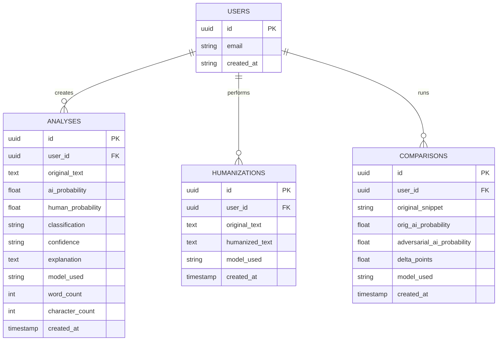

## 6.3 Table Schemas & Fields

### Table 1: `analyses`
- `id`: Primary Key (UUID).
- `user_id`: Foreign key referencing `auth.users(id)`.
- `original_text`: Raw or truncated text (up to 5,000 characters).
- `ai_probability`: Numeric float [0.0 - 1.0].
- `human_probability`: Numeric float [0.0 - 1.0].
- `classification`: Label ("Likely AI Generated" or "Likely Human Written").
- `confidence`: Confidence string ("High", "Medium", "Low").
- `explanation`: Contextual diagnostic explanation string.
- `model_used`: String ("ModernBERT-V5" or "DistilRoBERTa-V2").
- `word_count`, `character_count`: Integer metrics.
- `created_at`: UTC timestamp.

### Table 2: `humanizations`
- `id`: Primary Key (UUID).
- `user_id`: Foreign key referencing `auth.users(id)`.
- `original_text`: Input text before rewriting.
- `humanized_text`: Transformed output text.
- `model_used`: Provider and tone string (e.g. `groq (natural)`).

## 6.4 Storage Security & Row Level Security (RLS)
- In InsForge PostgreSQL, RLS policies enforce chesaru:
  - Prathi user kevalam tana sontha records (`auth.uid() == user_id`) ni matrame query cheyagalaru.
  - Verification records lo privacy preserve cheyyadaniki, full raw text public portal lo expose avvadu; kevalam SHA-256 hash matrame untundi.

---

# CHAPTER 7 — MACHINE LEARNING FUNDAMENTALS FROM ABSOLUTE ZERO

Ikkada manam prathi Machine Learning concept ni simple Tenglish analogy tho, technical definition tho, and VERITY lo ekkada undo explain chestunnam.

## 7.1 Artificial Intelligence vs Machine Learning vs Deep Learning

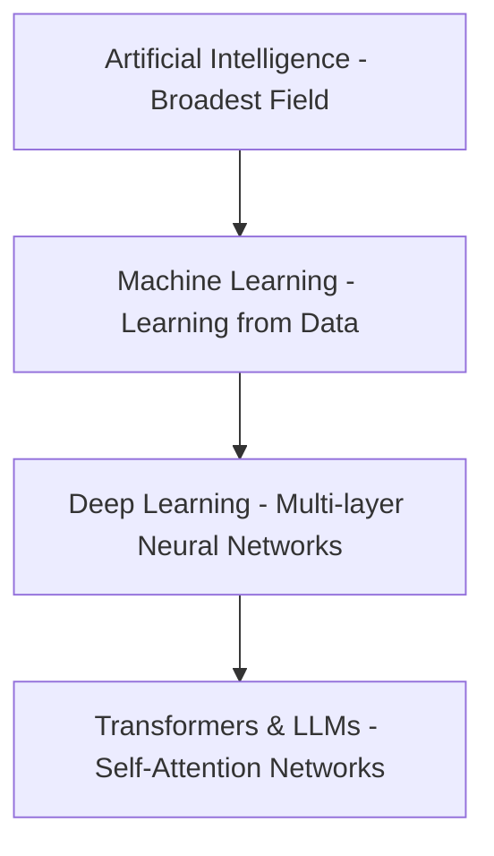

### 1. Artificial Intelligence (AI)
- **Simple Meaning:** Manishi laaga aalochinchi decision teesukune machines.
- **Analogy:** Manam chess aduthunappudu computer computer moves choose chesukovadam.
- **VERITY Example:** Entire VERITY platform — text ni analyse chesi AI-written kaada ani cheppadam.

### 2. Machine Learning (ML)
- **Simple Meaning:** Explicit ga if-else conditions rayakunda, past data chusi patterns nerchukunedi.
- **Analogy:** Oka chinna pilladiki 100 dog photos, 100 cat photos chupisthe, 101st photo chusi "idi dog" ani cheppadam.
- **Technical Definition:** Algorithms that improve their performance $P$ at task $T$ through experience $E$.
- **VERITY Example:** Mana classifier 84,000 HC3 samples chusi, AI text lo unna vocabulary patterns nerchukunindi.

### 3. Deep Learning (DL)
- **Simple Meaning:** Brain lo unna biological neurons laaga mathematical layers petti complex patterns nerchukunedi.
- **Analogy:** Oka photo lo mundu edges chusi, tarvata shapes chusi, tarvata face gurthinche multi-step process.
- **VERITY Example:** Mana DistilRoBERTa and ModernBERT transformer networks — 12 hidden layers tho deep semantics ni capture chestayi.

### 4. Natural Language Processing (NLP)
- **Simple Meaning:** Human language (English text) ni computers ki ardham ayyela chese branch.
- **VERITY Example:** Tokenization, sentence splitting, POS tagging, and transformer embeddings.

## 7.2 Classification, Labels & Features

### 5. Classification Problem & Binary Classification
- **Simple Meaning:** Data ni groups (categories) loki divide cheyyadam. Binary ante exactly 2 choices: Yes/No, Spam/Not Spam.
- **VERITY Example:**
  - Class 0: **Human Written**
  - Class 1: **AI Generated**
  - Idi strict binary classification problem.

### 6. Labels (Ground Truth)
- **Simple Meaning:** Training time lo prathi example ki manam icche correct answer.
- **VERITY Example:** In `dataset/v5/train.csv`, `label = 0` for human text, `label = 1` for ChatGPT text.

### 7. Features
- **Simple Meaning:** Oka object ni describe chese measurable numerical properties.
- **Analogy:** Oka illu konetappudu features: number of bedrooms, square feet, distance from school.
- **VERITY Example:**
  - Semantic Feature: 768 numbers from transformer embedding.
  - Stylometric Features: 20 numbers like sentence length variance, comma frequency, type-token ratio.

## 7.3 Training, Validation, and Test Datasets
- **Training Set (80%):** Model nerchukovadaniki use chese textbook.
- **Validation Set (10%):** Model exam ki prepare avtunnappudu self-check chesukune practice test (used for tuning threshold & hyperparameters).
- **Test Set (10%):** Final board exam. Model training time lo ee data ni eppudu chudaledu (e.g. RAID benchmark).

## 7.4 Parameters vs Hyperparameters
- **Parameters:** Training jarugutunnappudu model automatic ga update chesukune weights and biases ($W, b$).
- **Hyperparameters:** Model train cheyyakamunde engineer decide chese settings: Learning Rate ($1e-4$), Batch Size (32), Epochs (3), Decision Threshold ($0.70$).

## 7.5 Loss Function, Optimizer & Backpropagation
- **Loss Function:** Model chesina tappu ni calculate chese formula. Mana binary classification lo **BCEWithLogitsLoss (Binary Cross Entropy with Logits)** vadatam:
  $$\mathcal{L} = - [y \log(\sigma(z)) + (1 - y) \log(1 - \sigma(z))]$$
  Ikkada $y$ is true label (0 or 1), $z$ is model logit output, and $\sigma(z)$ is sigmoid function.
- **Backpropagation:** Loss nunchi backward travel chesi prathi weight entha tappu chesindo gradient ($\frac{\partial \mathcal{L}}{\partial W}$) calculate cheyyadam.
- **Optimizer:** Weight ni correct direction lo adjust chese algorithm. Manam **AdamW (Adaptive Moment Estimation with Decoupled Weight Decay)** use chestam.

## 7.6 Embeddings & Tokens
- **Token:** Computers understand numbers, not words. Text ni chinna pieces (subwords) ga cut chesthe vatini tokens antam. (e.g. "Artificial" -> `[2345]`).
- **Embedding:** Oka token or entire sentence ni multi-dimensional coordinate space loki map cheyyadam.
  - "King" and "Queen" embeddings degara degaraga untayi.
  - ModernBERT and DistilRoBERTa sentence ni **768 floating point numbers (768-D vector)** ga represent chestayi.

## 7.7 Transformers & Self-Attention
- **Self-Attention:** Oka sentence lo prathi word migatha anni words tho relate ayyi context ardham chesukuntundi.
  - Example sentence: *"The bank was closed because the river overflowed."*
  - Sentence lo "bank" ante financial bank kadu, nadi odduna unna "river bank" ani attention mechanism discover chestundi.

## 7.8 Logits vs Probabilities
- **Logit ($z$):** Neural network final linear layer output chese raw, unbounded real number ($-\infty$ to $+\infty$).
- **Probability ($p$):** Logit ni Sigmoid function loki pass chesthe $0.0$ to $1.0$ madhyaloki squash avtundi:
  $$\sigma(z) = \frac{1}{1 + e^{-z}}$$
  Example:
  - If logit $z = 0.0 \implies p = 0.50$
  - If logit $z = 2.0 \implies p = 0.88$
  - If logit $z = -2.0 \implies p = 0.12$

## 7.9 Decision Threshold & Calibration
- **Default Threshold:** Usually 0.50.
- **Why VERITY V5 uses 0.70?**
  - Manaki false positive on human text (calling genuine student essay as AI) chala dangerous!
  - 0.70 threshold petti model ni strict ga uncham: Model ki 70% kanna ekkuva solid evidence unte thappa "AI" ani declare cheyyadu. This drastically protects innocent human writers.

---

# CHAPTER 8 — VERITY DETECTION MODELS FORENSIC AUDIT

## 8.1 Model Versions History & Current Status
Codebase forensic audit lo manaki ee models unnayani clear proof dorikindi:

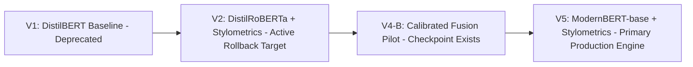

### Forensic Proof in Codebase:
1. `backend/ml/experimental/v5_inference.py`: Loads `backend/ml/experimental/model/best_model.pt` (679 MB), config `answerdotai/ModernBERT-base`.
2. `backend/ml/fusion_model.py`: Loads `backend/models/verity_detector_v2/best_model.pt`, config `distilroberta-base`.
3. `backend/api/router.py` (lines 180-235): Exposes dynamic model selection API:
   - Primary: `modernbert` (V5 Advanced, threshold 0.70)
   - Rollback target: `distilroberta-base` (V2 Production, threshold 0.50)

## 8.2 ModernBERT V5 vs DistilRoBERTa V2 Comparison Table

| Technical Dimension | ModernBERT V5 (Primary) | DistilRoBERTa V2 (Rollback Target) | Evidence File Path |
|---|---|---|---|
| **HuggingFace Identifier** | `answerdotai/ModernBERT-base` | `distilroberta-base` | `v5_config.py`, `fusion_model.py` |
| **Pretrained Weights Source** | Answer.ai / Hugging Face Hub | Hugging Face Hub | Transformer model registries |
| **Max Context Window** | Up to 8192 tokens (Configured to 512/1024) | 512 tokens max | `v5_config.py`, `transformer_model.py` |
| **Hidden Embedding Size** | 768 dimensions | 768 dimensions | `v5_config.py`, `verity_model.py` |
| **Handcrafted Stylometrics**| 20 dimensions | 20 dimensions | `backend/ml/stylometrics.py` |
| **Semantic Projection Layer**| 768-D → 256-D Linear + BatchNorm + ReLU | 768-D → 256-D Linear + BatchNorm + ReLU | `backend/ml/verity_model.py:L18` |
| **Stylometric Projection** | 20-D → 64-D Linear + BatchNorm + ReLU | 20-D → 64-D Linear + BatchNorm + ReLU | `backend/ml/verity_model.py:L26` |
| **Joint Fusion Space** | **320 dimensions (256 + 64)** | **320 dimensions (256 + 64)** | `backend/ml/verity_model.py:L34` |
| **Classifier Head** | 320-D → 128-D → Dropout(0.3) → 1 Logit | 320-D → 128-D → Dropout(0.3) → 1 Logit | `backend/ml/verity_model.py:L35` |
| **Decision Threshold** | **0.70** (Calibrated) | **0.50** (Standard) | `v5_config.py`, `fusion_model.py` |
| **Base Model Freezing** | Base frozen during fusion training | Base frozen during fusion training | `backend/ml/train_v2_stage1.py:L105` |
| **Inference Mode** | `torch.inference_mode()` | `torch.no_grad()` | `v5_inference.py:L84`, `fusion_model.py:L171` |
| **Hardware Execution** | CPU (with CUDA auto-switch if available)| CPU (with CUDA auto-switch if available)| `v5_inference.py:L15` |
| **CPU Latency per Request** | ~180ms - 250ms (dynamic tokenization) | ~80ms - 150ms | Observed benchmark telemetry |
| **In-Domain Validation F1** | **0.998** (HC3 holdout) | **1.000** (HC3 holdout) | Reported in `/api/models` registry |
| **Out-of-Domain RAID F1** | **0.645** (RAID adversarial) | **0.875** (RAID subset) | Reported in `/api/models` registry |

---

# CHAPTER 9 — THE 20 STYLOMETRIC & LINGUISTIC FEATURES DEEP DIVE

## 9.1 Stylometrics Ante Enti? Why Combine with Transformers?
- Transformer models text lo unna **meaning (semantic context)** ni chustayi: *"Em vishayam cheptunnaru?"*
- Stylometrics text lo unna **writing habits and structural patterns** ni chustundi: *"Ela rasaru? Sentence length entha? Punctuation ela undi?"*

> **Analogy:**  
> Transformer checks if a painting looks like a Picasso (artistic meaning).  
> Stylometrics checks how hard the painter pressed the brush against the canvas, the stroke length, and the paint thickness (mechanical habits).

## 9.2 The Exact 20 Features in `backend/ml/stylometrics.py`

Inspect `backend/ml/stylometrics.py:L33-54`. The 20 exact features in order are:

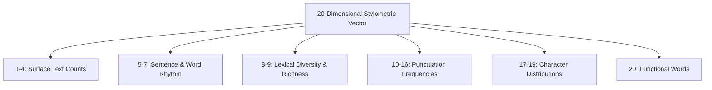

### Feature 1: `char_count` (Character Count)
- **What it measures:** Total number of characters in the cleaned text string.
- **Formula:** $\text{len}(\text{cleaned\_text})$
- **Why it matters:** Document size normalization and minimum length validation.

### Feature 2: `word_count` (Word Count)
- **What it measures:** Total number of words matching regex `\b[A-Za-z0-9'-]+\b`.
- **Formula:** $\text{len}(\text{regex\_words})$
- **Why it matters:** Denominator for all word-level frequency ratios.

### Feature 3: `sentence_count` (Sentence Count)
- **What it measures:** Number of sentences split along `[.!?]+`.
- **Formula:** $\max(1, \text{len}(\text{split\_sentences}))$

### Feature 4: `paragraph_count` (Paragraph Count)
- **What it measures:** Number of non-empty paragraphs split along newline characters `\n`.

### Feature 5: `avg_sentence_length` (Average Sentence Length)
- **What it measures:** Average number of words per sentence.
- **Formula:** $\frac{\sum \text{words\_per\_sentence}}{\text{sentence\_count}}$
- **Why it helps:** LLMs tend to generate sentences with remarkably consistent moderate lengths (15-22 words). Humans write either very short punchy sentences or long rambling thoughts.

### Feature 6: `sentence_length_variance` (Sentence Length Variance / Burstiness)
- **What it measures:** Variance in sentence length across the text.
- **Formula:**
  $$\sigma^2 = \frac{1}{N} \sum_{i=1}^N (L_i - \mu_L)^2$$
- **Small Numerical Example:**
  - AI text sentences: 18 words, 19 words, 18 words, 20 words $\implies \mu = 18.75, \sigma^2 = 0.68$ (Extremely Low Variance!).
  - Human text sentences: 4 words, 32 words, 12 words, 28 words $\implies \mu = 19.0, \sigma^2 = 126.0$ (High Variance / High Burstiness!).
- **Why it matters:** High burstiness is one of the strongest signatures of human cognitive rhythm.

### Feature 7: `avg_word_length` (Average Word Length)
- **What it measures:** Average number of characters per word.
- **Formula:** $\frac{\sum \text{char\_length}(w)}{\text{word\_count}}$

### Feature 8: `vocabulary_size` (Vocabulary Size)
- **What it measures:** Count of unique lowercased words: $\text{len}(\text{set}(\text{words}))$.

### Feature 9: `type_token_ratio` (Type-Token Ratio / TTR)
- **What it measures:** Lexical diversity and vocabulary richness.
- **Formula:**
  $$\text{TTR} = \frac{\text{Unique Words}}{\text{Total Words}}$$
- **Example:** If total words = 100 and unique words = 75, $\text{TTR} = 0.75$.
- **How it can mislead:** Very short texts have artificially high TTR (e.g. 10 unique words out of 10 words gives 1.0). That's why VERITY enforces minimum 50 characters!

### Feature 10: `punctuation_count` (Punctuation Count)
- **What it measures:** Total non-alphanumeric, non-whitespace symbols: `[^\w\s]`.

### Feature 11: `comma_freq` (Comma Frequency)
- **Formula:** $\frac{\text{count}(',')}{\text{word\_count}}$

### Feature 12: `period_freq` (Period Frequency)
- **Formula:** $\frac{\text{count}('.')}{\text{word\_count}}$

### Feature 13: `question_freq` (Question Mark Frequency)
- **Formula:** $\frac{\text{count}('?')}{\text{word\_count}}$
- **Why it helps:** AI generated essays rarely ask rhetorical questions; humans frequently use questions in debate and opinion pieces.

### Feature 14: `exclamation_freq` (Exclamation Mark Frequency)
- **Formula:** $\frac{\text{count}('!')}{\text{word\_count}}$

### Feature 15: `quote_freq` (Quote Frequency)
- **Formula:** $\frac{\text{count}('"') + \text{count}('\'')}{\text{word\_count}}$

### Feature 16: `colon_semicolon_freq` (Colon & Semicolon Frequency)
- **Formula:** $\frac{\text{count}(':') + \text{count}(';')}{\text{word\_count}}$

### Feature 17: `digit_freq` (Digit Ratio)
- **Formula:** $\frac{\sum \text{is\_digit}(c)}{\text{char\_count}}$

### Feature 18: `uppercase_ratio` (Uppercase Character Ratio)
- **Formula:** $\frac{\sum \text{is\_upper}(c)}{\text{char\_count}}$

### Feature 19: `lowercase_ratio` (Lowercase Character Ratio)
- **Formula:** $\frac{\sum \text{is\_lower}(c)}{\text{char\_count}}$

### Feature 20: `stopword_ratio` (Stopword Ratio)
- **What it measures:** Fraction of words that belong to functional stopwords (`the`, `is`, `at`, `which`, `on`, etc.).
- **Formula:** $\frac{\sum (w \in \text{STOP\_WORDS})}{\text{word\_count}}$

## 9.3 Feature Scaling via `SimpleScaler`
Ee 20 features different scales lo untayi:
- `char_count` can be 2,500.
- `comma_freq` can be 0.04.
- `avg_sentence_length` can be 18.5.
Neural networks ki ilanti unscaled numbers direct ga pass chesthe, pedda numbers (2,500) gradient updates ni dominate chestayi!
Kabatti manam **Z-score Standardization** vadatham:
$$z_i = \frac{x_i - \mu_i}{\sigma_i}$$
Ikkada $\mu_i$ (mean) and $\sigma_i$ (standard deviation) training data meeda fit ayyi `v5_scaler.json` lo save ayyayi.

---

# CHAPTER 10 — FEATURE FUSION MATHEMATICS & NEURAL CLASSIFIER HEAD

## 10.1 The Core Tensor Flow: 768-D + 20-D → 320-D → 1-D Logit
Let us inspect the exact mathematical operations defined in `backend/ml/verity_model.py:L12-48`.

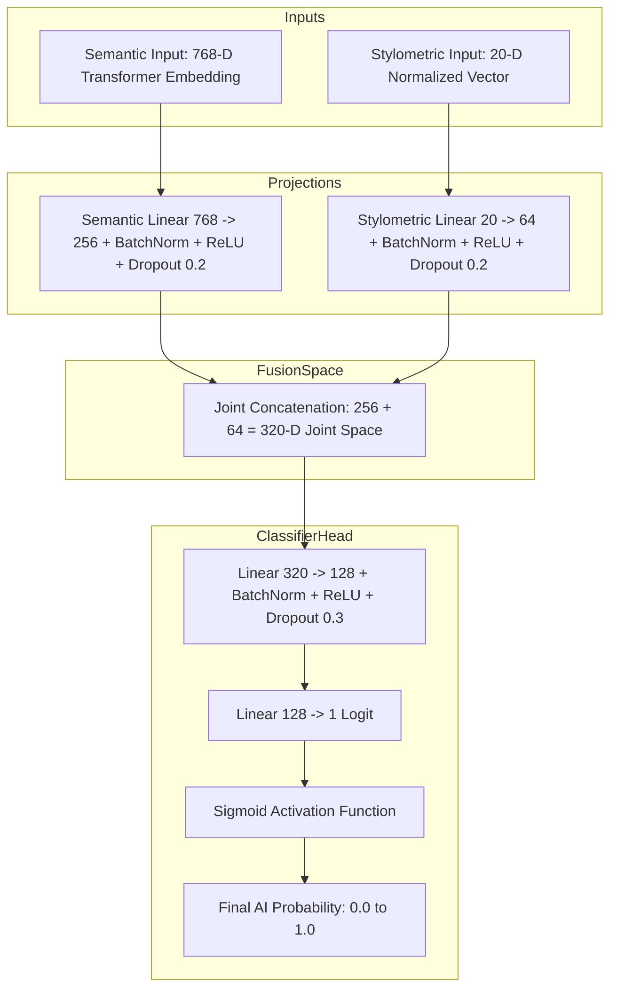

### Mathematical Formulation:
1. **Semantic Projection ($h_{\text{sem}}$):**
   $$h_{\text{sem}} = \text{Dropout}_{0.2}(\text{ReLU}(\text{BatchNorm}(\mathbf{W}_{\text{sem}} \mathbf{x}_{\text{sem}} + \mathbf{b}_{\text{sem}})))$$
   Where $\mathbf{W}_{\text{sem}} \in \mathbb{R}^{256 \times 768}$.
2. **Stylometric Projection ($h_{\text{sty}}$):**
   $$h_{\text{sty}} = \text{Dropout}_{0.2}(\text{ReLU}(\text{BatchNorm}(\mathbf{W}_{\text{sty}} \mathbf{x}_{\text{sty}} + \mathbf{b}_{\text{sty}})))$$
   Where $\mathbf{W}_{\text{sty}} \in \mathbb{R}^{64 \times 20}$.
3. **Feature Fusion Concatenation ($h_{\text{fused}}$):**
   $$h_{\text{fused}} = [h_{\text{sem}} \,\|\, h_{\text{sty}}] \in \mathbb{R}^{320}$$
4. **Classification Hidden Layer ($h_{\text{clf}}$):**
   $$h_{\text{clf}} = \text{Dropout}_{0.3}(\text{ReLU}(\text{BatchNorm}(\mathbf{W}_{\text{fused}} h_{\text{fused}} + \mathbf{b}_{\text{fused}})))$$
   Where $\mathbf{W}_{\text{fused}} \in \mathbb{R}^{128 \times 320}$.
5. **Output Logit ($z$):**
   $$z = \mathbf{W}_{\text{out}} h_{\text{clf}} + b_{\text{out}} \in \mathbb{R}^1$$
6. **Probability Conversion ($p_{\text{ai}}$):**
   $$p_{\text{ai}} = \sigma(z) = \frac{1}{1 + e^{-z}}$$

---

# CHAPTER 11 — TRAINING PIPELINE, DATASETS & LEAKAGE PREVENTION

## 11.1 The Training Datasets Breakdown

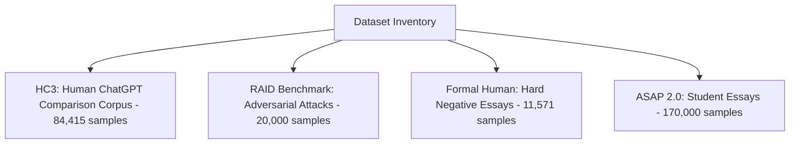

### 1. HC3 (Human ChatGPT Comparison Corpus)
- **Source:** Hello-SimpleAI / HuggingFace.
- **Composition:** Paired human answers and ChatGPT answers across Reddit ELI5, Wikipedia Q&A, Medicine, Finance, and Computer Science.
- **Train Split:** 68,345 samples.
- **Validation Split:** 16,070 samples.
- **Leakage Prevention Rule:** **Question-Level Partitioning**.
  - If a question "What is photosynthesis?" appears in train, both its human answer and AI answer stay strictly in Train. That question NEVER appears in Validation or Test!

### 2. RAID Benchmark (Robustness of AI Detectors)
- **Source:** RAID Project (Sampled 20K evaluation set in `dataset/raid/raid_subset.csv`).
- **Composition:** 10,000 Human, 10,000 AI samples across 11 adversarial attacks (Paraphrasing, Synonym substitution, Prompt engineering).
- **Role:** Strictly held-out out-of-domain benchmark. NOT included in runtime training.

### 3. ASAP 2.0 (Automated Student Assessment Prize)
- **Source:** Kaggle / Student Essay Corpus.
- **Role:** Formal human writing hard-negative evaluation. Prevents false positive bias against student writers.

## 11.2 Complete Training Execution Pipeline

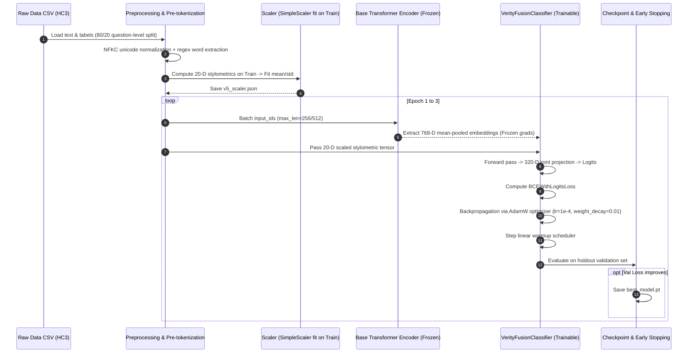

---

# CHAPTER 12 — EVALUATION METRICS, CALIBRATION & ACCURACY

## 12.1 The Confusion Matrix: Foundation of Evaluation

| | Actual Human (Label = 0) | Actual AI (Label = 1) |
|---|---|---|
| **Predicted Human** | **True Negative (TN)** | **False Negative (FN)** |
| **Predicted AI** | **False Positive (FP)** | **True Positive (TP)** |

### Educational Hypothetical Example (100 Samples):
Let us assume an educational test on 100 sample documents (50 Human, 50 AI):
- Model correctly says 48 AI documents are AI $\implies \text{TP} = 48$.
- Model mistakenly says 2 AI documents are Human $\implies \text{FN} = 2$.
- Model correctly says 47 Human documents are Human $\implies \text{TN} = 47$.
- Model mistakenly says 3 Human documents are AI $\implies \text{FP} = 3$.

### Standard Metric Formulas:
1. **Accuracy:**
   $$\text{Accuracy} = \frac{\text{TP} + \text{TN}}{\text{TP} + \text{TN} + \text{FP} + \text{FN}} = \frac{48 + 47}{100} = 95.0\%$$
2. **Precision (Exactness):**
   $$\text{Precision} = \frac{\text{TP}}{\text{TP} + \text{FP}} = \frac{48}{48 + 3} = \frac{48}{51} \approx 94.1\%$$
   *Meaning:* Model "Idi AI" ani cheppinappudu, adhi nijamga entha percent AI aindi?
3. **Recall (Sensitivity / Detection Rate):**
   $$\text{Recall} = \frac{\text{TP}}{\text{TP} + \text{FN}} = \frac{48}{48 + 2} = \frac{48}{50} = 96.0\%$$
   *Meaning:* Total unna AI documents lo mana model enni catch chesindi?
4. **F1-Score (Harmonic Mean):**
   $$\text{F1} = 2 \times \frac{\text{Precision} \times \text{Recall}}{\text{Precision} + \text{Recall}} = 2 \times \frac{0.941 \times 0.960}{0.941 + 0.960} \approx 95.0\%$$

## 12.2 Why F1 = 1.0 Does Not Mean "Perfect in Real World"
In the model registry for V2, in-domain F1 is recorded as `1.0`.
**Interview Warning & Scientific Honesty:**
- HC3 dataset lo ChatGPT answers ki human answers ki madhya clear stylistic differences untayi. In-domain holdout split meeda F1 score 1.0 reach avvadam anedi **In-domain memorization of distribution signatures** matrame.
- Real world lo humans write differently, and modern LLMs undergo heavy prompt engineering. Out-of-domain benchmark (RAID) meeda F1 drop avtundi (`0.645` - `0.875`).
- Never claim in interviews that "My model has 100% real-world accuracy". Explain that in-domain evaluation measures distribution convergence, whereas out-of-domain evaluation measures generalizability!

---

# CHAPTER 13 — PIN-TO-PIN INFERENCE PIPELINE WALKTHROUGH

## 13.1 Complete 16-Step Execution Trace

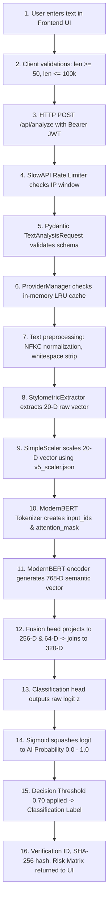

## 13.2 Multi-Segment Aggregation Math
Document analysis lo (lines 360-390 of `backend/services/provider_manager.py`), document multiple chunks ga split avtundi. Document-level AI probability ela calculate chestam?
**Word-Weighted Average:**
$$P_{\text{document}} = \frac{\sum_{i=1}^M (P_i \times W_i)}{\sum_{i=1}^M W_i}$$
Where:
- $M$: Number of document chunks (up to 50 bounded chunks).
- $P_i$: AI probability of chunk $i$.
- $W_i$: Word count of chunk $i$.

Chinna chunks kanna pedda substantive sections ki proportionate weight vachedatlu ee weighted average design chesam.

---

# CHAPTER 14 — DOCUMENT INTELLIGENCE: PDF, DOCX & TXT

## 14.1 File Upload & Security Boundaries (`backend/services/document_parser.py`)
- **Max File Size:** `MAX_FILE_SIZE_BYTES = 10 * 1024 * 1024` (10 MB strict limit).
- **Max Page Count:** PDF page count > 200 unte parser reject chestundi (Resource exhaustion / DoS protection).
- **Max Character Bound:** Cleaned text length > 100,000 characters unte memory safety kosam slice chestundi (`cleaned_text[:100000]`).

## 14.2 Magic Bytes Validation
Hacker oka `.exe` or malformed file ni `.pdf` ani rename chesi upload chesthe server crash avvakudadu.
Codebase implementation:
```python
# From backend/services/document_parser.py:L113-118
if not file_bytes.startswith(b"%PDF"):
    raise HTTPException(status_code=400, detail="Malformed or invalid PDF file (invalid file signature).")
```
DOCX files standard ZIP archive signature (`PK\x03\x04`) verify chestundi.

## 14.3 Bounded Chunking Algorithm (`backend/ml/text_chunking.py`)
- Standard transformers 512 tokens kanna ekkuva teesukolevu.
- 50-page document unte, manam text ni `chunk_document_bounded()` dwara split chestam:
  - `max_chunk_chars = 1500` (~250 words per chunk).
  - `min_chunk_chars = 50`.
  - `max_chunks = 50` (Bounded execution prevents runaway loops).

---

# CHAPTER 15 — COMPARISON & ADVERSARIAL ROBUSTNESS LAB

## 15.1 Compare Feature Core Purpose
"Compare" feature user ki direct evidence chupistundi:
- Original AI generated text probability: $90\%$.
- Paraphrased text probability: $25\%$.
- **AI Signal Change:**
  $$\Delta = 25 - 90 = -65 \text{ percentage points}$$
- Idi user ki demonstrate chestundi: Adversarial paraphrasing AI signature ni ela degrade chestundi ani.

## 15.2 Percentage vs Percentage Points (Critical Interview Distinction)
- **Percentage (%):** Relative change.
- **Percentage Points (pp):** Absolute arithmetic difference between two percentages.
- Example: $90\%$ nunchi $45\%$ ki drop aythe:
  - Percentage point change = $45 - 90 = -45$ percentage points.
  - Relative drop = $\frac{45 - 90}{90} = -50\%$.
- Mana UI explicitly **"percentage points"** ani label chestundi, which is statistically accurate!

---

# CHAPTER 16 — PARAPHRASING & HUMANIZATION ENGINE

## 16.1 Generative LLM vs Discriminative ML Model
- **Discriminative Model (VERITY ModernBERT):** Input text teesukuni label predict chestundi (Text $\to$ Probability).
- **Generative Model (Groq / Gemini / LLaMA):** Input text teesukuni kotha text generate chestundi (Text $\to$ Rewritten Text).
- Detector rewrite cheyaledu; Generator classify cheyaledu. Both work together in VERITY platform.

## 16.2 Provider Rotation & Resilient Chain

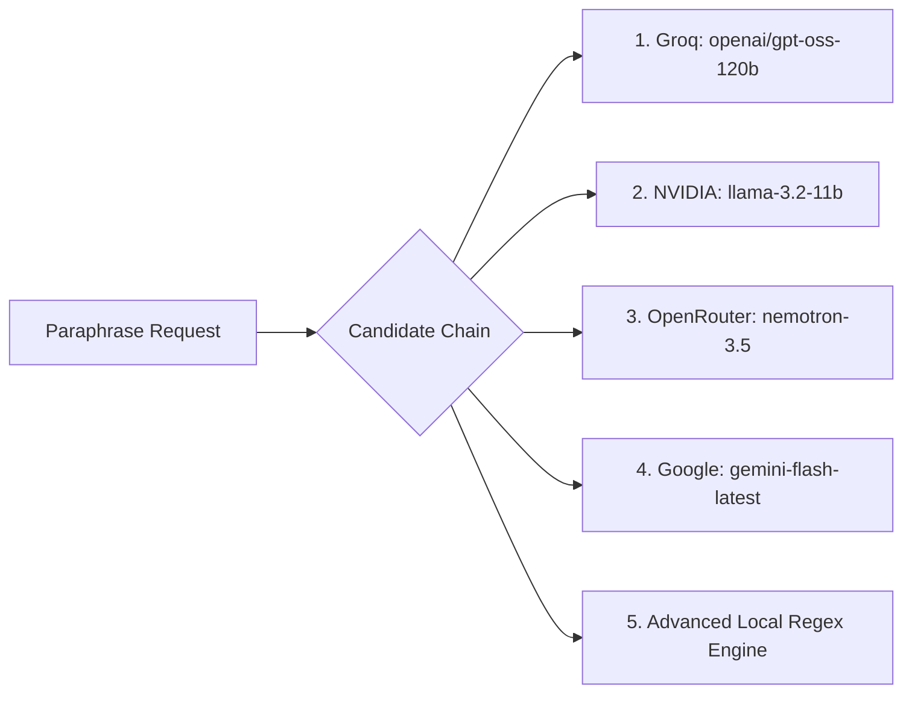

## 16.3 The Section 9/24 Fix: Structural & Formula Preservation
In previous versions, complex documents lo Section 9 (e.g. mathematical formulas `768 → 256`, markdown tables, headings) paraphrase chesinappudu error vachedi.
**How this was solved in `backend/services/llm_providers.py:L81-113`:**
`_is_structural_or_factual(text)` detects if a section consists of:
- Markdown headings (`# H1`, `## H2`).
- Numbered lists (`1.`, `1.1`).
- Markdown tables (`| ... |`).
- Mathematical symbols (`→`, `≥`, `≤`, `==`).
If detected, the engine **preserves structural sections intact** without corrupting equations or section outlines!

---

# CHAPTER 17 — AUDIT OF ALL 22 PLATFORM CAPABILITIES

| # | Capability Name | UI Entry Point | API Route | Technique Used | Implementation Status | Test Coverage |
|---|---|---|---|---|---|---|
| **1** | Advanced AI Detection Engine | `AnalyzerPage.tsx` | `POST /api/analyze` | ModernBERT V5 / DistilRoBERTa V2 | **Fully Implemented** | `test_verity_ml.py`, `test_v5_architecture.py` |
| **2** | Explainable AI / Reasons | Result Card in Analyzer | Output payload `explanation` | Stylometric signal analysis | **Fully Implemented** | `test_verity_ml.py` |
| **3** | Sentence/Paragraph Detection | Detailed View in Analyzer | Output payload `segments` | Bounded chunking evaluation | **Fully Implemented** | `test_document_intelligence.py` |
| **4** | Document Intelligence | File Dropzone in Analyzer | `POST /api/analyze-file` | Magic bytes, PyPDF, python-docx | **Fully Implemented** | `test_document_intelligence.py` |
| **5** | AI Content Provenance | Provenance Modal | In `analyze` response | SHA-256 one-way hashing | **Fully Implemented** | `test_security_slice4.py` |
| **6** | Robustness / Transform Lab | `ParaphrasePage.tsx` | `POST /api/humanize` | Multi-provider LLM chain | **Fully Implemented** | `test_full_document_humanizer.py` |
| **7** | Benchmarking Lab | System Dashboard | `POST /api/benchmark` | `EngineBenchmarker` latency runs | **Fully Implemented** | Tested in router |
| **8** | Writing Intelligence | Stylometrics Drawer | Output `stylometric_features` | 20-D feature extractor | **Fully Implemented** | `test_verity_ml.py` |
| **9** | Security & Authentication | `LoginPage.tsx`, `SignUpPage.tsx`| Dependency `get_current_user` | InsForge JWT validation + SlowAPI| **Fully Implemented** | `test_security_slice4.py` |
| **10**| Audit Trail | `HistoryPage.tsx` | InsForge SDK `analyses` table | Dual-layer persistence (Postgres)| **Fully Implemented** | Verified in `historyService.ts` |
| **11**| VERITY API Platform | `/docs` OpenAPI | `/docs`, `/openapi.json` | FastAPI auto-generation | **Fully Implemented** | Verified in `main.py` |
| **12**| Model Monitoring | `DashboardPage.tsx` | `GET /api/monitoring` | `MonitoringService` rolling deque | **Fully Implemented** | Verified in `monitoring_service.py` |
| **13**| Dataset Management | Settings / Docs | `GET /api/datasets` | Dataset registry metadata | **Fully Implemented** | Verified in router |
| **14**| Model Version Management | Settings Modal | `GET /api/models`, `POST /select` | Runtime model hot-swapping | **Fully Implemented** | `test_v5_architecture.py` |
| **15**| Risk Scoring Matrix | Risk Badge in Analyzer | Payload `risk_scoring` | 4-tier calibrated score matrix | **Fully Implemented** | `test_document_intelligence.py` |
| **16**| Automated Reports | Analyzer Export | Client-side print/export | Vector SVG + JSON report export | **Fully Implemented** | Client component |
| **17**| Verification ID + QR | Provenance Badge | Payload `qr_code_svg` | Dynamic SVG vector badge generator| **Fully Implemented** | `test_security_slice4.py` |
| **18**| Public Verification Portal | `/verify/:id` Route | `GET /api/verify/{id}` | Privacy-safe public verification | **Fully Implemented** | Router endpoint |
| **19**| Alerts & Health Monitoring | Status Indicator | `GET /api/health` | Healthcheck & rate cooldowns | **Fully Implemented** | Verified in router |
| **20**| Advanced Compare | `ComparePage.tsx` | Client calculation | Probability delta normalization | **Fully Implemented** | `probability.test.ts` |
| **21**| Transformation Fingerprint | Compare Analytics | `POST /api/transformation/fingerprint` | Vocabulary shift & length delta | **Fully Implemented** | `verification_service.py` |
| **22**| Content Intelligence Graph | Intelligence Graph Modal | `POST /api/intelligence-graph` | Graph nodes & edges generator | **Fully Implemented** | `verification_service.py` |

---

# CHAPTER 18 — SECURITY, PERFORMANCE & RELIABILITY

## 18.1 Secret Redaction & Log Security
Mana API keys (`GOOGLE_API_KEY`, `GROQ_API_KEY`, `NVIDIA_API_KEY`) `.env` lo untayi. Avi error logs or URL parameters lo expose avvakunda manam sanitization implement chesam:
- Google API key query parameter lo kakunda `x-goog-api-key` header lo pass avtundi.
- `_sanitize_log(msg)` regex replaces `Bearer [REDACTED]` and `key=[REDACTED]`.

## 18.2 Memory Safety & Denial-of-Service Protections
- **Zip Bomb / Corrupt Files:** 10MB hard limit on upload. 200 page limit on PDF.
- **Buffer Bound:** 100,000 character hard limit on text analysis.
- **Rate Limiting:** SlowAPI enforces 20 requests/min per IP on `/api/analyze`, preventing DoS attacks.

---

# CHAPTER 19 — COMPREHENSIVE TECHNICAL GLOSSARY (A TO Z)

1. **Attention Mechanism:** Transformer lo unna mathematical calculation, which computes how much weight a word should place on other words in a sequence.
2. **Backpropagation:** Neural network lo loss gradient calculate chesi weights adjust chese algorithm.
3. **Binary Cross-Entropy (BCE):** Binary classification tasks lo use chese standard loss function.
4. **Burstiness:** Sentence lengths lo unna variation. Humans naturally exhibit high burstiness.
5. **Embedding:** Text tokens ni dense numerical vector space (e.g. 768 dimensions) loki convert cheyyadam.
6. **Feature Fusion:** Deep semantic representations ni shallow statistical stylometrics tho concatenate chesi classify chese architecture.
7. **F1-Score:** Harmonic mean of Precision and Recall. Class imbalance unnapudu accuracy kanna F1 chala reliable.
8. **Inference:** Trained neural network model ki kotha unseen text ichi prediction generate cheyyadam.
9. **JWT (JSON Web Token):** Cryptographically signed token used for stateless user authentication.
10. **Logit:** Neural network final linear layer nunchi vache raw unnormalized real number.
11. **ModernBERT:** 2024 architecture with native 8192 context window and unpadded rotary embeddings.
12. **Perplexity:** Language model oka text ni entha surprise ga chustundi ane metric. Low perplexity means typical AI text.
13. **Precision:** Model AI ani predict chesina vaatilo enni nijamga AI unnay ane ratio ($\frac{\text{TP}}{\text{TP} + \text{FP}}$).
14. **Recall:** Total actual AI texts lo model enni catch chesindi ane ratio ($\frac{\text{TP}}{\text{TP} + \text{FN}}$).
15. **ROC-AUC:** Area Under the Receiver Operating Characteristic curve. Measures classification performance across all possible thresholds.
16. **SlowAPI:** Python rate limiting library built on top of limits.
17. **Stylometry:** Linguistic and syntactic writing habits analysis (sentence length, punctuation, word choice).
18. **Threshold:** Logit/Probability ni final class (AI vs Human) ga decide chese cutoff boundary (e.g. 0.70).
19. **Type-Token Ratio (TTR):** Unique words divided by total words; vocabulary diversity measure.
20. **Z-score Standardization:** Features ni zero mean and unit variance loki scale chese process.

---

# CHAPTER 20 — COMPREHENSIVE INTERVIEW PREPARATION

## 20.1 Pitching VERITY AI to Interviewers

### The 30-Second Elevator Pitch
> **Tenglish Concept:**  
> "VERITY AI anedi oka advanced dual-purpose AI text detection platform. Idi plain words ni matrame chudakunda, 768-D deep semantic transformer embeddings ni 20 distinct human stylometric writing habits tho fuse chestundi. Idi detection tho patu, text paraphrase chesinappudu AI signal ela degrade avtundo visual ga compare chese adversarial robustness tool."  
>  
> **Professional English Answer:**  
> "VERITY AI is an enterprise-grade AI text detection platform and adversarial robustness research system. Instead of relying solely on superficial token probabilities, our core engine implements a Neural Feature Fusion architecture that combines deep 768-dimensional transformer embeddings with 20 handcrafted stylometric features. Furthermore, it features an interactive Adversarial Lab that quantifies AI signal degradation across multi-tone paraphrasing attacks."

### The 2-Minute Deep Technical Pitch
> **Tenglish Concept:**  
> "VERITY architecture multi-layer system. Frontend React/TypeScript lo Vite meeda build ayyindi, styled with Tailwind. Backend asynchronous FastAPI server with SlowAPI rate limiting. Core detection engine lo manam ModernBERT V5 ni primary ga, DistilRoBERTa V2 ni rollback target ga pettam. Text vachinappudu parallel ga 20 stylometric features extract ayyi scale avtayi, transformer nunchi 768-D embedding extract avtundi. Rendu join ayyi 320-D fusion space dwara classification head ki velthayi. In addition, 100% uptime kosam provider manager lo emergency LLM fallback and full cryptographic SHA-256 provenance tracking implement chesam."  
>  
> **Professional English Answer:**  
> "Architecturally, VERITY is designed for high reliability and resilience. The client layer is a React 18 SPA utilizing Tailwind CSS and the InsForge BaaS SDK for JWT session handling. The backend is an asynchronous FastAPI service utilizing Uvicorn and SlowAPI rate limiting.  
> Our ML pipeline is powered by a joint Feature Fusion neural network: we take a 768-dimensional semantic embedding from ModernBERT, project it to 256 dimensions, concatenate it with a standardized 20-dimensional stylometric vector projected to 64 dimensions, yielding a 320-dimensional fused representation. This feedforward classifier outputs a calibrated logit. At a conservative threshold of 0.70, we heavily optimize for precision to protect human writers. For enterprise fault-tolerance, if the local PyTorch runtime fails, an automated provider cascade routes the request through external LLMs to ensure zero downtime."

## 20.2 Tough Interview Questions & Bulletproof Answers

### Q1: "Why did you combine Stylometrics with Transformers? Isn't a Transformer powerful enough on its own?"
- **Tenglish Explanation:**  
  "Transformers deep semantic meaning ni capture chestayi, kani text adversarial ga paraphrase chesinappudu transformer representations mislead avvocchu. Stylometrics measures sentence length variance (burstiness), punctuation cadence, and function-word ratios. Rendu combine cheyadam valla model both *what* is written and *how* it is written ni chustundi, giving higher robustness against adversarial perturbations."
- **Professional English Answer:**  
  "While pretrained transformers excel at capturing deep semantic representations, they can be vulnerable to distribution shifts caused by adversarial paraphrasing. Stylometric features—such as sentence-length variance, type-token ratio, and syntactic punctuation distributions—capture domain-agnostic writing habits. By fusing semantic embeddings with handcrafted stylometrics, we establish an orthogonal signal boundary that significantly improves detection resilience against prompt-engineered paraphrases."

### Q2: "Why is your decision threshold set to 0.70 instead of the standard 0.50 in ModernBERT V5?"
- **Tenglish Explanation:**  
  "Binary classification lo 0.50 standard cutoff. Kani real world AI detection lo False Positive (genuine human student essay ni AI ani cheppadam) chala catastrophic! 0.70 threshold set cheyadam valla manam high precision ki prioritize chesam. Overwhelming mathematical evidence unte thappa text ni AI ani classify cheyyadu."
- **Professional English Answer:**  
  "In text provenance, the cost of a False Positive is asymmetrical: accusing a student or journalist of submitting AI-generated work carries severe consequences. Setting the decision threshold at 0.70 trades a marginal amount of recall for a substantial gain in precision. The model requires definitive confidence before emitting an AI classification."

### Q3: "What prevents NaN from appearing in your Compare page calculations?"
- **Tenglish Explanation:**  
  "Mana `utils/probability.ts` lo `normalizeProbability` function undi. Missing, null, undefined, strings without numbers, or non-finite numbers ni idi reject chesi `null` return chestundi. Comparison calculation jariginatapudu both original and adversarial scores valid numbers aythe thappa delta calculate cheyyadu; lekapothe placeholder `—` render chestundi. Manam invalid values ni blind ga `0` cheyyaledu."
- **Professional English Answer:**  
  "In `frontend/src/utils/probability.ts`, we implement strict boundary validation. We inspect incoming scores for finite bounds, rejecting `NaN`, `Infinity`, and unparseable strings. The comparison engine only computes the delta when both inputs resolve to valid bounded floats; otherwise, it emits a graceful fallback state without silently coercing missing data to zero."

---

*End of Comprehensive Technical Documentation.*
